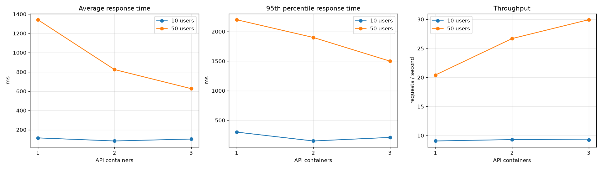

# Financial Document Classification – End-to-End ML Pipeline

An end-to-end machine learning pipeline that classifies the **scanned documents a lender receives with a
credit application** into 9 types: budget, email, form, handwritten, invoice, letter, memo, questionnaire and
resume. It covers data acquisition, preprocessing, transfer-learning model training, evaluation, a FastAPI
backend, a React dashboard, bulk upload and retraining with a promotion gate, Docker scaling behind an Nginx
load balancer, and Locust load testing.

African Leadership University – BSE – *Machine Learning Pipeline* summative.

| | |
|---|---|
| Video demo | _YouTube link: to be added_ |
| Live app | _Deployment URL: to be added_ |
| Notebook | [`notebook/document_classification.ipynb`](notebook/document_classification.ipynb) |
| Model file | [`models/doc_classifier_v1.h5`](models/) (Keras HDF5) |

---

## 1. Problem statement

This project builds on my *Introduction to Machine Learning* summative, **credit card default risk
prediction**, which scored clients from tabular data. Before any credit decision, a lender has to sort the
documents an applicant submits: invoices and budgets as evidence of income and spending, resumes and letters
as employment evidence, and forms and questionnaires from the application itself. Doing this by hand is slow
and error-prone.

**Goal:** given a scanned page, predict its document type so it can be routed automatically, with
low-confidence pages sent to a human reviewer. The data is **images** rather than tables, as the brief
requires.

## 2. Dataset

* **Source:** **RVL-CDIP** (Harley, Ufkes & Derpanis, *"Evaluation of Deep Convolutional Nets for Document
  Image Classification and Retrieval"*, ICDAR 2015; [homepage](https://www.cs.cmu.edu/~aharley/rvl-cdip/)):
  400,000 scanned business documents in 16 types. It is used in two forms:
  * **Training data:** the full dataset on Kaggle,
    [`abdellatifsassioui/rvlcdip`](https://www.kaggle.com/datasets/abdellatifsassioui/rvlcdip).
    `scripts/build_rvl_subset.py` samples **2,000 train / 250 validation / 250 test** images per type from
    the official splits (18,000 / 2,250 / 2,250 images). The model is trained in a Kaggle GPU notebook.
  * **API data:** [RVL-CDIP small-200](https://huggingface.co/datasets/vaclavpechtor/rvl_cdip-small-200)
    on Hugging Face (200 per type). `scripts/download_data.py` downloads it into `data/train`, `data/val` and
    `data/test`. Its **test split (40 per type, 360 images)** is what the running API evaluates on and what
    the retraining promotion gate uses. Its images were excluded from the Kaggle sample, so it stays unseen.
* **Classes used:** the 9 of 16 types relevant to lending. Advertisements, scientific papers, news articles
  and similar types are excluded.
* The datasets are **not committed** because of their size. Eighteen sample test images (2 per type) and the
  precomputed dataset statistics behind the dashboard (`data/dataset_stats.json`, 22,500 images) are
  committed.

## 3. Architecture

```
                ┌──────────────────────── Docker Compose ────────────────────────┐
 Browser ──────►│ nginx :8080                                                     │
 Locust  ──────►│  ├─ /            → React dashboard (static build)               │
                │  └─ /api/*  ──round-robin──► api_1 │ api_2 │ api_3 (FastAPI+TF) │
                │                                   │                             │
                │              shared volumes: models/ (model + registry.json)    │
                │                              data/   (dataset + uploads)        │
                │                              runtime/ (retraining status/lock)  │
                └─────────────────────────────────────────────────────────────────┘
```

| Layer | Technology | Files |
|---|---|---|
| Data acquisition | Hugging Face Hub, Pillow | `scripts/download_data.py` |
| Preprocessing | Pillow, NumPy | `src/preprocessing.py` |
| Model | TensorFlow/Keras **MobileNetV2** (transfer learning) | `src/model.py`, `src/train.py` |
| Prediction | Keras, hot-reloading predictor | `src/prediction.py` |
| Retraining | background thread + promotion gate + model registry | `src/retrain.py`, `src/registry.py`, `src/upload_validation.py` |
| API | FastAPI + Uvicorn (Swagger at `/docs`) | `src/api/main.py` |
| Dashboard | React (Vite) + Recharts | `frontend/` |
| Load balancing | Nginx (Docker DNS round-robin) | `docker/nginx.conf` |
| Containers | Docker, Docker Compose | `Dockerfile`, `frontend/Dockerfile`, `docker-compose.yml` |
| Load testing | Locust | `locust/`, `scripts/run_load_tests.sh` |

## 4. Repository structure

```
README.md  Dockerfile  docker-compose.yml  requirements.txt  requirements-dev.txt  .env.example
notebook/document_classification.ipynb   training + evaluation notebook (executed, with outputs)
src/        preprocessing.py  model.py  prediction.py  train.py  retrain.py  registry.py
            upload_validation.py  dataset_stats.py  config.py  api/main.py
data/       train/ val/ test/ (downloaded)   samples/ (committed)   dataset_stats.json   uploads/
models/     doc_classifier_v1.h5  registry.json  metrics.json  history.json
frontend/   React dashboard + Dockerfile
docker/     nginx.conf
locust/     locustfile.py  plot_results.py  results/
tests/      pytest suite (preprocessing, prediction, registry, upload validation, retraining, API)
scripts/    download_data.py  build_rvl_subset.py  build_notebook.py  run_load_tests.sh  start.sh
```

## 5. Setup and running

**Requirements:** Docker with Docker Compose v2. Node 20+ is only needed for frontend development.

```bash
git clone https://github.com/ingdia/image-classification-ml-pipeline.git
cd image-classification-ml-pipeline
cp .env.example .env                       # optional: adjust settings

# 1. Download the dataset (about 1 minute; builds data/train, data/val, data/test)
docker compose --profile dev run --rm dev python scripts/download_data.py

# 2. Start the app: API + nginx + dashboard
docker compose up -d --build
#    Dashboard:    http://localhost:8080
#    Swagger docs: http://localhost:8080/docs

# 3. Scale to 3 API containers behind the load balancer
docker compose up -d --scale api=3
```

The trained model `models/doc_classifier_v1.h5` is committed, so the app works without retraining.
Prediction does not need the dataset. Retraining and live evaluation do need it.

### Train from scratch

```bash
docker compose --profile dev run --rm dev python -m src.train          # command-line training
# or run the notebook and save its outputs:
docker compose --profile dev run --rm dev jupyter nbconvert --to notebook --execute --inplace \
    --ExecutePreprocessor.timeout=-1 notebook/document_classification.ipynb
```

### Run the tests

```bash
docker compose --profile dev run --rm dev pytest -q
```

## 6. Using the pipeline

### Predict
Open the dashboard's **Predict** tab. Drop a scanned page, or click a sample type to load a test document,
then click **Predict**. The predicted type, its confidence, and the probability for every type are shown.

### Upload data and retrain
1. **Upload & Retrain** tab: choose a document type, select many images (or a ZIP with one folder per type),
   then click **Upload**. Each file is validated: allowed type, size limit, decodable image, minimum
   resolution and known label. Rejected files are listed with the reason.
2. Click **Retrain model**. A copy of the live model is fine-tuned in the background on the original
   training data plus the uploads. Progress is shown per epoch.
3. **Promotion gate:** the candidate is evaluated on the fixed test set and promoted only if
   `candidate accuracy ≥ live accuracy − 1 pp`. Otherwise it is **rejected** and the live model keeps
   serving. Every version is recorded in `models/registry.json`. All API containers hot-reload a promoted
   model without restarting.

### Monitor and evaluate in production
The header shows **online status, uptime, model version and the container that answered**, refreshed every
5 seconds. The **Model Performance** tab shows test metrics, the confusion matrix, training curves and the
version history. **Evaluate live model now** re-scores the currently deployed model on the test set inside the
running container.

## 7. API

Interactive documentation is at `/docs` (Swagger UI). Through nginx, every path is prefixed with `/api`.

| Method | Path | Description |
|---|---|---|
| GET | `/health` | Status, uptime, model version, container id |
| POST | `/predict` | Predict the type of one image (`file`) |
| POST | `/upload` | Bulk upload of labelled images or ZIPs (`files`, `label`) for retraining |
| POST | `/validate` | Dry-run validation of files without saving them |
| GET / DELETE | `/uploads` | Uploads waiting for the next retraining, or clear them |
| POST | `/retrain` | Start background retraining (202, or 409 if one is already running) |
| GET | `/retrain/status` | queued / running (epoch progress) / promoted / rejected / failed |
| GET | `/metrics` | Live model test metrics, training history, version history |
| POST | `/evaluate` | Evaluate the live model on the test set now (evaluation in production) |
| GET | `/dataset/stats` | Dataset features used by the visualisations |
| GET | `/samples`, `/samples/{name}` | Demo test documents |

Example:
```bash
curl -F "file=@data/samples/invoice_0000327323.png" http://localhost:8080/api/predict
```

## 8. Model results

Model **v1** is MobileNetV2 (ImageNet weights) trained on a **Kaggle T4 GPU** in two stages: first the
classifier head, then the top 60 layers fine-tuned. Training used **18,000 images** (2,000 per type) sampled
from the official splits of the full RVL-CDIP, ran for 27 epochs and took 17.7 minutes. The run is in
[`notebook/document_classification.ipynb`](notebook/document_classification.ipynb) with all its outputs.

It is evaluated on two held-out test sets that were never used for training or model selection:

| Metric | RVL-CDIP test sample (2,250 images) | API test set (360 images) |
|---|---|---|
| Accuracy | **71.6 %** | **73.6 %** |
| Precision (macro) | 74.2 % | 75.3 % |
| Recall (macro) | 71.6 % | 73.6 % |
| F1-score (macro) | 71.6 % | 73.6 % |

Chance level is 11.1 % for 9 balanced types. The API test set is the one the deployed API re-scores with
**Evaluate live model** and uses in the retraining promotion gate. Its metrics are in `models/metrics.json`;
the larger sample's are in `models/metrics_rvl_test.json`.

**Why the dataset was enlarged.** The first version was trained on RVL-CDIP small-200, with only 128 images
per type, and reached **52.2 %**. Training on 2,000 per type from the full RVL-CDIP (via Kaggle) and
fine-tuning more layers raised accuracy by about 20 points. The 3,603 small-200 images were excluded from the
sample, so the API test set stays unseen.

Per type on the RVL-CDIP test sample:

| Type | Precision | Recall | F1 |
|---|---|---|---|
| email | 0.97 | 0.86 | **0.91** |
| resume | 0.96 | 0.72 | **0.83** |
| handwritten | 0.62 | 0.97 | **0.76** |
| invoice | 0.74 | 0.70 | 0.72 |
| budget | 0.67 | 0.67 | 0.67 |
| letter | 0.64 | 0.70 | 0.67 |
| form | 0.63 | 0.69 | 0.66 |
| questionnaire | 0.61 | 0.66 | 0.63 |
| memo | 0.85 | 0.47 | 0.61 |

Confusion matrix on the RVL-CDIP test sample (rows = true type, columns = predicted type, 250 per row):

| true \ pred | bud | ema | for | han | inv | let | mem | que | res |
|---|---|---|---|---|---|---|---|---|---|
| budget | **167** | 0 | 23 | 12 | 17 | 3 | 3 | 25 | 0 |
| email | 4 | **214** | 9 | 4 | 1 | 6 | 1 | 8 | 3 |
| form | 16 | 1 | **173** | 21 | 18 | 6 | 4 | 11 | 0 |
| handwritten | 1 | 0 | 1 | **243** | 1 | 0 | 0 | 4 | 0 |
| invoice | 28 | 0 | 17 | 14 | **175** | 9 | 1 | 6 | 0 |
| letter | 6 | 2 | 5 | 35 | 10 | **175** | 9 | 6 | 2 |
| memo | 12 | 1 | 15 | 17 | 5 | 59 | **118** | 22 | 1 |
| questionnaire | 8 | 2 | 24 | 38 | 9 | 1 | 1 | **166** | 1 |
| resume | 9 | 0 | 6 | 9 | 1 | 16 | 2 | 26 | **181** |

**Interpretation**
* **Types with a distinctive layout are recognised reliably.** When the model says *email* or *resume* it
  is right 96–97 % of the time.
* **The most common error is memo → letter (59 of 250 memos).** Both are blocks of typed paragraphs, and the
  "MEMORANDUM" header is too small to read at 224×224. Memos therefore have high precision (0.85) but low
  recall (0.47).
* **Handwritten absorbs messy pages.** It finds 97 % of handwritten notes, but questionnaires and letters
  with handwriting on them are also predicted as handwritten (precision 0.62).
* **Grid documents** (budget, invoice, form, questionnaire) are confused with one another, as the
  ink-density analysis in the notebook predicted.
* Training accuracy (81 %) is about 11 points above validation accuracy (70 %): mild overfitting, limited by
  augmentation, dropout and early stopping. In production, low-confidence pages should go to a human
  reviewer.

## 9. Load testing (flood request simulation)

[Locust](https://locust.io) simulates users who each upload a random scanned document to `POST /api/predict`
(plus an occasional health check), waiting 0.5–1.5 s between requests. The same test ran against
**1, 2 and 3 API containers** behind the nginx load balancer, with **10 and 50 concurrent users**, for 60 s
each. Each container is limited to 2 CPU cores, like one small server. A request that takes longer than 30 s
counts as a failure.

```bash
scripts/run_load_tests.sh 60s "10 50" "1 2 3"   # runs all 6 tests, raw CSVs -> locust/results/raw/
python locust/plot_results.py                    # -> locust/results/summary.md + scaling.png
```

| Containers | Users | Requests | Failure rate | Throughput (req/s) | Avg (ms) | Median (ms) | p95 (ms) | p99 (ms) |
|---|---|---|---|---|---|---|---|---|
| 1 | 10 | 535 | 0.0% | 9.1 | 116 | 85 | 300 | 530 |
| 2 | 10 | 549 | 0.0% | 9.3 | 84 | 76 | 150 | 290 |
| 3 | 10 | 546 | 0.0% | 9.3 | 104 | 96 | 210 | 320 |
| 1 | 50 | 1,207 | 0.0% | 20.4 | 1,342 | 1,400 | 2,200 | 2,400 |
| 2 | 50 | 1,579 | 0.0% | 26.7 | 825 | 730 | 1,900 | 2,200 |
| 3 | 50 | 1,771 | 0.0% | 29.9 | 627 | 560 | 1,500 | 2,000 |



**What the results show**
* **10 users: one container is enough.** Users only send about 9 requests per second, which one container
  handles with a median of 85 ms. Adding containers barely changes anything, because nothing is queuing.
* **50 users: one container saturates.** Demand rises to about 30 requests per second. One container
  reaches only 20 req/s, so requests queue and the average response time jumps to 1.3 s.
* **Scaling out fixes it.** With 3 containers, throughput rises by **47 %** (20.4 → 29.9 req/s), the average
  response time falls by **53 %** (1,342 → 627 ms) and the median by 60 % (1,400 → 560 ms). No request failed
  in any test. The load balancer spreads requests across the replicas, as shown by the container id that
  answers each request (`X-Upstream` header and `/health`).
* **Compiled inference matters as much as scaling.** The first version called the Keras model eagerly
  (~300 ms per image); the API now runs it through a compiled `tf.function` (~45 ms). Before that change, a
  single container already took 3.6 s (median) at 10 users.
* The test machine has a fixed number of CPU cores shared by all containers and by Locust, so the gain from
  each extra container shrinks. On a cloud platform, each replica gets its own CPU.

## 10. Deployment

_Filled in after deployment._

## 11. Limitations

* Pages are downscaled to 224×224, so small text is unreadable and the model relies on layout. Visually
  similar types (memo vs. letter, form vs. questionnaire) are the most confused.
* The documents are 1980s–90s US corporate scans (RVL-CDIP), not African bank documents.
* Retraining runs in a thread inside the API container. A production system would use a job queue
  (for example Celery + Redis) and a model registry service (for example MLflow).
